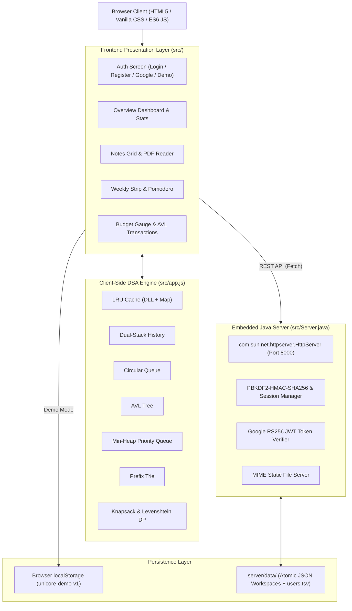

# 🎓 UniCore — Smart Student Life & Study OS

<p align="center">
  
  
  
  
  
  
</p>

> **UniCore** is a zero-dependency, local-first academic operating dashboard that unifies student knowledge management, daily scheduling, focus rhythms, and expense tracking into one cohesive interface. 
> 
> Designed as a flagship **Data Structures & Algorithms (DSA) Major Project**, every functional module is powered by custom-engineered algorithmic implementations rather than third-party libraries or standard SQL engines.

---

## 📑 Table of Contents

- [1. Academic Overview & Metadata](#1-academic-overview--metadata)
- [2. Problem Statement](#2-problem-statement)
- [3. Key Highlights & Features](#3-key-highlights--features)
- [4. Data Structures & Algorithms (DSA) Engine](#4-data-structures--algorithms-dsa-engine)
- [5. System Architecture](#5-system-architecture)
- [6. Directory & Project Structure](#6-directory--project-structure)
- [7. Installation & Quick Start](#7-installation--quick-start)
- [8. Authentication & Security Model](#8-authentication--security-model)
- [9. Keyboard Shortcuts & Workflow Guide](#9-keyboard-shortcuts--workflow-guide)
- [10. Telemetry & Algorithm Verification](#10-telemetry--algorithm-verification)
- [11. Future Scope](#11-future-scope)
- [12. References & Acknowledgments](#12-references--acknowledgments)

---

## 1. Academic Overview & Metadata

- **Project Title:** UniCore — Smart Student Life & Study OS
- **Lead Developer:** Sitanshu Kumar *(Roll No: `[Add Roll Number]`)*
- **Project Mentor / Guide:** `[Add Guide / Mentor Name]`
- **Institution:** Rungta International Skill University (RISU), Bhilai
- **Course / Stream:** Computer Science & Engineering (DSA Major Project)
- **Runtime Environment:** Java 17+ Standard Edition (`jdk.httpserver`), Modern Evergreen Web Browsers
- **External Dependencies:** **0 (Zero)** — 100% native Java SE and pure Vanilla Web APIs.

---

## 2. Problem Statement

Modern university students operate in a highly fragmented digital ecosystem:
- **Scattered Utilities:** Notes are taken in separate editors, schedules live in calendars, assignments are tracked in spreadsheets, and expenses are managed in mobile apps.
- **Cognitive Overhead:** Switching between disjointed apps leads to lost focus, missed deadlines, and poor study habits.
- **Academic Relevance:** Traditional software engineering courses often teach Data Structures & Algorithms in isolation via console scripts. UniCore solves both challenges simultaneously: providing an intuitive personal productivity hub while showcasing **12 core DSA concepts powering real, interactive UI workflows**.

---

## 3. Key Highlights & Features

### 📖 Study Notes & Knowledge Hub
- **Instant Search & Categorization:** Organize lecture notes by folders, color tags, and priority stars.
- **LRU Memory Cache:** Keeps the 5 most recently accessed notes in an in-memory doubly linked list for instantaneous retrieval.
- **PDF Upload & Storage:** Attach and preview original lecture slides and PDF notes directly within the workspace.
- **PDF Export Engine:** Compiles notes into a clean, downloadable `.pdf` document without external rendering libraries.

### ⏱️ Dynamic Planner & Focus Pipeline
- **Visual Weekly Timeline:** Plan classes, study blocks, and personal routines across an interactive week strip.
- **Pomodoro Circular Queue:** Continuously rotates focus intervals (25 min) and restorative breaks (5 min / 15 min) with single-click cycle advancement.
- **Knapsack Study Optimizer:** Uses 0/1 Dynamic Programming to pick the highest-value combination of study tasks fitting into a student's available free hours.

### 💰 Personal Finance & Split Manager
- **Categorized Spending:** Track expenses across food, travel, study resources, and miscellaneous categories.
- **Interactive Budget Gauge:** Live monthly budget tracking with 12-month historical expenditure visualizer.
- **AVL Tree Amount Filter:** Rapidly query transactions falling within any minimum and maximum monetary range.
- **Greedy Group Debt Settlement:** Minimizes cash transfers among project peers using dual min-heaps.

### 🧭 Campus Directions & Academic Roadmap
- **Live Campus Navigation:** Embedded interactive route map for Rungta International Skills University, Bhilai, with quick shortcuts to popular transit hubs.
- **Dijkstra Route Calculation:** Algorithmic shortest-path engine ready for custom walking-network navigation.
- **Topological Prerequisite Roadmap:** Determines the optimal chapter study sequence avoiding circular dependencies.

### 🔐 Dual-Mode Workspace & Local-First Privacy
- **Account Mode:** Private multi-user accounts secured with salted PBKDF2 password hashes or Google Identity Services.
- **Demo Mode:** Fully loaded with realistic sample student data saved exclusively to browser `localStorage`.
- **Dual-Stack Undo / Redo:** Full session state versioning with `Ctrl+Z` and `Ctrl+Shift+Z`.

---

## 4. Data Structures & Algorithms (DSA) Engine

Every feature in UniCore is built on custom DSA implementations located in [`src/app.js`](file:///c:/Users/sitan/Desktop/antigravity%20projects/unicore/src/app.js). No external collections or algorithmic libraries are used.

```
                                  UNICORE DSA ENGINE
 ┌──────────────────────┬─────────────────────────┬───────────────────────────────┐
 │     LINEAR DATA      │       TREE & HEAP       │      GRAPH & OPTIMIZATION     │
 ├──────────────────────┼─────────────────────────┼───────────────────────────────┤
 │ • LRU Cache (DLL+Map)│ • AVL Balanced BST      │ • Weighted Graph + Dijkstra   │
 │ • Dual Stacks (Undo) │ • Binary Min-Heap       │ • Kahn's Topological Sort     │
 │ • Circular Queue     │ • Prefix Trie           │ • Disjoint Set (Union-Find)   │
 │ • Chained Hash Table │ • Bloom Filter          │ • 0/1 Knapsack & Levenshtein  │
 └──────────────────────┴─────────────────────────┴───────────────────────────────┘
```

### Detailed DSA Matrix

| # | Concept / Data Structure | Class / Function | Application Feature | Time Complexity | Auxiliary Space |
| :---: | :--- | :--- | :--- | :---: | :---: |
| **1** | **Doubly Linked List + Hash Map** | `LRUCache` | 5-item recently opened notes cache | Lookup: $\mathcal{O}(1)$<br>Eviction: $\mathcal{O}(1)$ | $\mathcal{O}(K)$ $(K=5)$ |
| **2** | **Dual Stacks (LIFO)** | `UndoStack` | State-level undo and redo history | Push: $\mathcal{O}(1)$<br>Pop: $\mathcal{O}(1)$ | $\mathcal{O}(S \times N)$ |
| **3** | **Circular Queue** | `CircularQueue` | Rotating Pomodoro study & break pipeline | Enqueue: $\mathcal{O}(1)$<br>Rotate: $\mathcal{O}(1)$ | $\mathcal{O}(N)$ |
| **4** | **AVL Tree (Self-Balancing BST)** | `AVLTree`, `AVLNode` | Expense indexing & numeric range searches | Insert: $\mathcal{O}(\log N)$<br>Range: $\mathcal{O}(\log N + M)$ | $\mathcal{O}(N)$ |
| **5** | **Binary Min-Heap** | `MinHeap` | Deadline priority queue & debt simplification | Insert: $\mathcal{O}(\log N)$<br>Extract-Min: $\mathcal{O}(\log N)$ | $\mathcal{O}(N)$ |
| **6** | **Prefix Trie** | `Trie`, `TrieNode` | Universal command bar (`Ctrl+K`) prefix matching | Lookup: $\mathcal{O}(L + M)$<br>Insert: $\mathcal{O}(L)$ | $\mathcal{O}(\Sigma \times L)$ |
| **7** | **Chained Hash Table** | `HashTable` | Note keyword inverted index (53 buckets, FNV-1a) | Lookup: Avg $\mathcal{O}(1)$<br>Worst $\mathcal{O}(N)$ | $\mathcal{O}(N)$ |
| **8** | **Bloom Filter** | `BloomFilter` | Duplicate keyword screening before note saving | Add: $\mathcal{O}(k)$<br>Query: $\mathcal{O}(k)$ $(k=2)$ | $\mathcal{O}(M)$ $(256 \text{ bits})$ |
| **9** | **Weighted Graph + Dijkstra** | `Graph` | Shortest walking routes across campus landmarks | Shortest Path:<br>$\mathcal{O}((V + E) \log V)$ | $\mathcal{O}(V + E)$ |
| **10**| **Kahn's Topological Sort** | `topological()` | Course chapter roadmap ordered by prerequisites | Ordering:<br>$\mathcal{O}(V + E)$ | $\mathcal{O}(V + E)$ |
| **11**| **Disjoint Set (Union-Find)** | `UnionFind` | Study group & project collaboration clustering | Find: $\mathcal{O}(\alpha(N))$<br>Union: $\mathcal{O}(\alpha(N))$ | $\mathcal{O}(N)$ |
| **12**| **Dynamic Programming (Knapsack)**| `knapsack()` | Selects highest-value tasks within time limit | Time: $\mathcal{O}(n \times W)$<br>Space: $\mathcal{O}(W)$ | $\mathcal{O}(n \times W)$ |
| **13**| **Dynamic Programming (Edit Dist)**| `editDistance()`| Fuzzy search when user types typos in command bar | Time: $\mathcal{O}(m \times n)$<br>Space: $\mathcal{O}(\min(m, n))$ | $\mathcal{O}(n)$ |
| **14**| **Huffman Coding** | `huffman()` | Frequency-tree text compression archive (.huff) | Encoding:<br>$\mathcal{O}(N \log K)$ | $\mathcal{O}(K)$ |

---

## 5. System Architecture



### Key Technical Pillars:
1. **Zero External Dependencies:** Built entirely with standard APIs. No Node.js build tools, no React runtime, and no external Java JARs.
2. **Local-First Speed:** Instant UI state transitions with asynchronous, debounced server persistence (250ms).
3. **Hot Static Reloading:** The Java backend reads files directly from `src/` on every HTTP request, allowing immediate front-end iterations without restarting the server.

---

## 6. Directory & Project Structure

```text
unicore/
├── README.md                      # Comprehensive academic & project documentation
├── run.bat                        # One-click Windows development launcher
├── .gitignore                     # Git ignore rules (excludes data, classes, temp files)
├── src/                           # Application source code
│   ├── Server.java                # Native Java 17+ HTTP server, auth & JSON persistence
│   ├── index.html                 # Semantic application views, modals & layout
│   ├── app.js                     # Custom DSA implementations, UI rendering & client logic
│   └── styles.css                 # Responsive stylesheet & design system
├── server/
│   └── data/                      # Auto-created at runtime for account persistence
│       ├── users.tsv              # Base64-encoded user accounts with password salts & hashes
│       └── <uuid>.json            # Individual user workspace files (atomic writes)
├── docs/                          # Project reports and documentation
│   └── README.md
└── screenshots/                   # Application screenshots for evaluation
    └── README.md
```

---

## 7. Installation & Quick Start

### Prerequisites
- **Operating System:** Windows, Linux, or macOS.
- **Java Runtime:** Java Development Kit (JDK) 17 or higher (`java -version` should confirm 17+).
- **Web Browser:** Any modern browser (Chrome, Edge, Firefox, Safari).

### Quick Start (Windows)
Double-click [`run.bat`](file:///c:/Users/sitan/Desktop/antigravity%20projects/unicore/run.bat) or run the following in PowerShell:

```powershell
.\run.bat
```

### Manual Execution (Any Platform)
Open your terminal in the repository root directory and run:

```bash
java --add-modules jdk.httpserver src/Server.java
```

Once started, navigate to:
```
http://localhost:8000
```

> [!TIP]
> **Choosing a Workspace Mode:**
> - Click **Explore demo mode** to test the system immediately with realistic student data without signing up.
> - Click **Create account** or **Sign in** to maintain your private, persistent workspace.

### Optional: Google Sign-in Configuration
Google OAuth Web Client ID is pre-configured. To point to your own Google Cloud Client ID, set the environment variable prior to launch:

```bat
set UNICORE_GOOGLE_CLIENT_ID=your-client-id.apps.googleusercontent.com
run.bat
```

---

## 8. Authentication & Security Model

UniCore implements enterprise-grade authentication standards directly in Java without third-party frameworks:

```
[ User Password ] ──► [ Random 16-byte Salt ] ──► [ PBKDF2-HMAC-SHA256 (210,000 iterations) ] ──► [ 256-bit Key ]
```

- **Salted PBKDF2 Hashing:** Passwords are never stored in plaintext. They undergo 210,000 rounds of PBKDF2 with SHA-256 and unique per-user cryptographically random salts (`SecureRandom`).
- **Timing-Attack Resistance:** Password hashes are evaluated using constant-time comparison via `MessageDigest.isEqual`.
- **Brute-Force Throttling:** Failed login attempts are throttled with a mandatory 650ms artificial sleep per target email.
- **RS256 JWT Verification:** Google ID tokens are verified natively: public keys are downloaded from Google cert endpoints, checked against `Cache-Control: max-age`, and RSA signatures, audience, issuer, and expiry timestamps are verified.
- **Atomic File Swapping:** Workspace files are written to `.tmp` files and moved atomically using `StandardCopyOption.ATOMIC_MOVE` to prevent file corruption during power loss.

---

## 9. Keyboard Shortcuts & Workflow Guide

| Shortcut | Scope | Action |
| :--- | :--- | :--- |
| <kbd>Ctrl</kbd> + <kbd>K</kbd> / <kbd>Cmd</kbd> + <kbd>K</kbd> | Global | Open universal command palette (trie + fuzzy search) |
| <kbd>Ctrl</kbd> + <kbd>Z</kbd> / <kbd>Cmd</kbd> + <kbd>Z</kbd> | Global | Undo last change (reverts from `UndoStack`) |
| <kbd>Ctrl</kbd> + <kbd>Shift</kbd> + <kbd>Z</kbd> | Global | Redo last reverted change |
| <kbd>Esc</kbd> | Global | Dismiss modal dialogs, menus, and command bar |
| <kbd>↑</kbd> / <kbd>↓</kbd> + <kbd>Enter</kbd> | Command Bar | Navigate and execute search suggestions |

---

## 10. Telemetry & Algorithm Verification

UniCore includes an active **DSA Telemetry HUD** that measures real-time execution times for algorithmic operations:

```text
[LRU CACHE]      Accessed "Data Structures — Trees" · 5/5 notes in memory (0.12 ms)
[AVL TREE]       Inserted Expense ₹240 · balanced index updated (0.18 ms)
[TRIE]           Prefix "data" matched 2 note titles (0.09 ms)
[KNAPSACK DP]    Selected 3 tasks · 185 of 240 min (0.34 ms)
[GREEDY + HEAP]  Simplified group balances to 4 transfers (0.21 ms)
[UNDO STACK]     Schedule updated · Undo depth 4
```

This telemetry feed allows students, teachers, and project evaluators to observe theoretical data structures executing dynamically in response to user actions.

---

## 11. Future Scope

- [ ] **Interactive Campus Graph:** Expand the Rungta University map with draggable nodes and Dijkstra visual step-by-step animation.
- [ ] **Spaced-Repetition System (Anki Algorithm):** Incorporate SM-2 flashcard intervals linked with study notes.
- [ ] **Topological Dependency Editor:** Visual canvas to add, link, and reorder syllabus prerequisites.
- [ ] **Multi-Device LAN Sync:** Peer-to-peer WebSocket synchronization across campus networks.
- [ ] **Automated Test Suite:** Unit tests verifying AVL balancing, heap invariants, and trie lookups.

---

## 12. References & Acknowledgments

- **Oracle Java 17 Documentation:** [`com.sun.net.httpserver.HttpServer`](https://docs.oracle.com/en/java/javase/17/docs/api/jdk.httpserver/com/sun/net/httpserver/HttpServer.html)
- **Google Identity Services:** [Sign In With Google for Web](https://developers.google.com/identity/gsi/web)
- **RFC 2898:** [PKCS #5: Password-Based Cryptography Specification (PBKDF2)](https://datatracker.ietf.org/doc/html/rfc2898)
- **Thomas H. Cormen, Charles E. Leiserson, Ronald L. Rivest, Clifford Stein:** *Introduction to Algorithms (CLRS)*
- **Institution:** Rungta International Skill University, Bhilai.

---

<p align="center">
  <b>UniCore</b> — Crafted with passion for student productivity and data structures.
</p>
