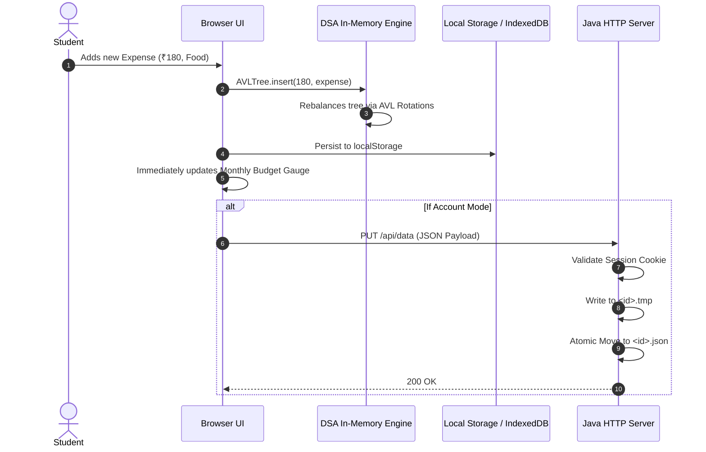

# UniCore — System Architecture & Design Specification

This document details the architectural principles, component models, data flows, and security design governing the UniCore Student Life OS.

---

## 1. High-Level Architectural Pattern

UniCore employs a **Local-First Thin-Server Architecture**. Core business rules, data structures, and state mutations live in volatile and persistent client memory, while the server acts as an authenticated synchronization target and static asset gateway.

```
+-------------------------------------------------------------------+
|                        CLIENT BROWSER                             |
|                                                                   |
|   +-----------------------------------------------------------+   |
|   |                  UI Component Layer                       |   |
|   |   (Overview, Study Notes, Planner, Expenses, Command)     |   |
|   +-----------------------------+-----------------------------+   |
|                                 |                                 |
|   +-----------------------------v-----------------------------+   |
|   |                 Handcrafted DSA Subsystems                |   |
|   |  LRU Cache | AVL Tree | Min-Heap | Trie | DSU | Knapsack   |   |
|   +-----------------------------+-----------------------------+   |
|                                 |                                 |
|   +-----------------------------v-----------------------------+   |
|   |               Client Storage Abstraction                  |   |
|   |   IndexedDB (PDF Blobs) <---> localStorage (JSON Cache)   |   |
|   +-----------------------------+-----------------------------+   |
+---------------------------------|---------------------------------+
                                  | HTTP / Same-Origin REST
                                  v
+-------------------------------------------------------------------+
|                      NATIVE JAVA SERVER                           |
|                      (Server.java - Port 8000)                    |
|                                                                   |
|   +-----------------------------+-----------------------------+   |
|   |     HttpServer Routing      |    PBKDF2 Auth & Session    |   |
|   |    (/api/data, /api/me)     |      (210,000 Iterations)   |   |
|   +-----------------------------+-----------------------------+   |
|                                 |                                 |
|   +-----------------------------v-----------------------------+   |
|   |                  Atomic File System I/O                   |   |
|   |             users.tsv <---> server/data/<id>.json         |   |
|   +-----------------------------------------------------------+   |
+-------------------------------------------------------------------+
```

---

## 2. Component Subsystems

### 2.1 UI Layer (Pure Vanilla Web Technologies)
- **Structure (`src/index.html`):** Semantic HTML5 shell with accessibility landmarks (`<main>`, `<aside>`, `<nav>`, `<header>`).
- **Styling (`src/styles.css`):** Custom CSS design tokens, flexbox/grid layouts, micro-animations, glassmorphic modals, and multi-colored segmented gauges.
- **Controller & Algorithms (`src/app.js`):** Modular event delegation, real-time index rebuilding, and reactive DOM rendering.

### 2.2 Storage Layer
- **IndexedDB:** Database `unicore_pdf_files` with object store `pdfs` stores binary PDF blobs via non-blocking asynchronous transactions.
- **HTML5 Web Storage:** Serialized JSON snapshots stored under key `unicore-v1` (Account) and `unicore-demo-v1` (Demo).

### 2.3 Backend Micro-Server (`src/Server.java`)
- **Runtime:** Single Java source compilation/launch via JDK 17+ `java --add-modules jdk.httpserver src/Server.java`.
- **Concurrency:** Thread pool executor sizing dynamically to available CPU cores:
  ```java
  server.setExecutor(Executors.newFixedThreadPool(Math.max(4, Runtime.getRuntime().availableProcessors())));
  ```
- **Session Management:** Cryptographically random 32-byte session tokens mapped in a `ConcurrentHashMap<String, String>` and sent via `HttpOnly; SameSite=Lax; Max-Age=604800` headers.

---

## 3. Data Synchronization Flow



---

## 4. Security & Cryptographic Model

1. **Password Storage:** Uses PBKDF2 with HMAC-SHA256, 210,000 iterations, and unique 16-byte cryptographically secure random salts.
2. **Session Cookies:** Strict `HttpOnly` flag prevents XSS session hijacking; `SameSite=Lax` mitigates CSRF attacks.
3. **MIME Sniffing Protection:** Every HTTP response includes `X-Content-Type-Options: nosniff`.
4. **Cache Invalidation:** Static assets and API endpoints declare `Cache-Control: no-cache, no-store, must-revalidate` to prevent stale script execution in public student computer labs.
